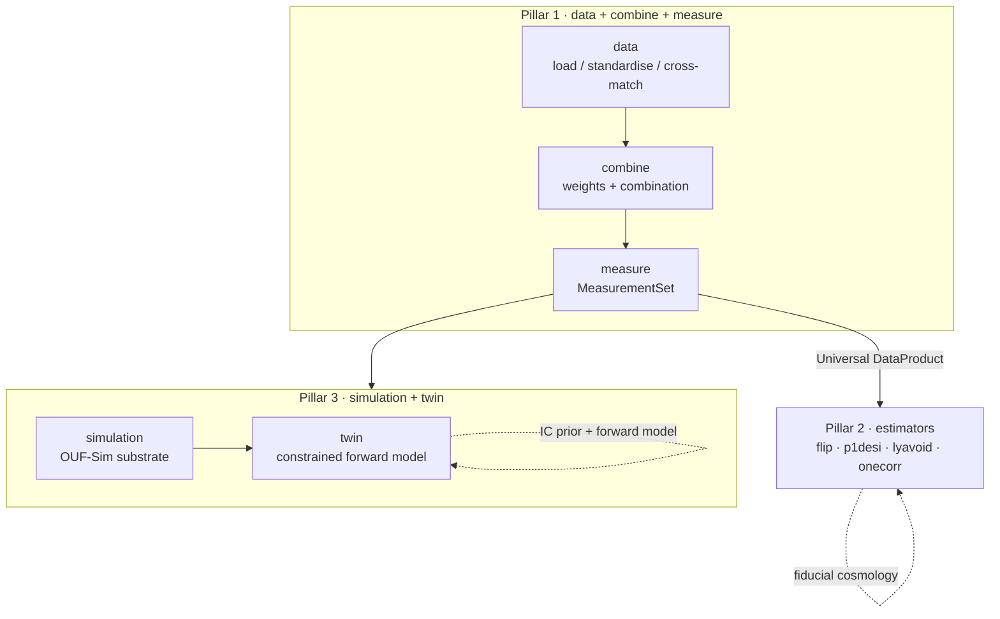

# Architecture

`oneuniverse` is the anchor of a three-pillar cosmology stack whose long-term
goal is a **digital twin of the Universe**: a single posterior on the matter
density and velocity field built by combining every cosmological observation.
This package is the data and orchestration substrate. It ships no estimators and
no samplers.



## The pillars

| Pillar | Mission | Subpackage(s) | Owns cosmology? |
|---|---|---|---|
| **1: data, combine, measure** | Ingest catalogs, standardise, cross-match, weight, emit a `MeasurementSet` | [`data`](api/data.md), [`combine`](api/combine.md), [`measure`](api/measure.md) | **No** |
| **2: estimators and likelihoods** | P(k), xi(r), C_l, fits, forecasts | *external (flip, pycorr, picca, ...)* | **Yes** (fiducial at the call site) |
| **3: simulation and digital twin** | Store simulation products, couple data and simulation | [`simulation`](api/simulation.md), [`twin`](api/twin.md), [`reference`](api/reference.md) | **Yes**, inside the engines |

### The cosmology rule

`data`, `combine` and `measure` store survey-delivered data verbatim, with
observational metadata only (frame, epoch, wavelength convention). H0, Omega_m,
a fiducial baseline or a distance model never touch the catalog: they enter in
the estimator call, or in a simulation engine. The same prepared data stay
reusable under any fiducial. `test/test_guards.py` enforces this by walking the
AST of the three subpackages, and `MeasurementSet` rejects cosmology-derived
column names.

## Pillar 1: data, combine, measure

- **[`data`](api/data.md)**: survey loaders and `convert`, the OUF 3.0 writer
  and `DatasetView` (lazy, partial reads), `Database` (a root of datasets with
  bitemporal `as_of`), cross-survey matching (ONEUID), sub-object links, photo-z
  PDFs, and the DuckDB SQL face. RA and Dec are stored in degrees (ICRS).
- **[`combine`](api/combine.md)**: `Weight` primitives (FKP, inverse variance,
  column, quality mask, healpix map, shear) that compose with `*`, a registry of
  default weights per survey kind and `z_type`, and `WeightedCatalog`, which
  combines the measurements of one object across surveys.
- **[`measure`](api/measure.md)**: `build_pointset` is the one spine from an OUF
  view to a `Product`: select, clean, quality cut, weight, window, regions,
  n(z), randoms, provenance. The presets `galaxy_clustering`, `cosmic_shear` and
  `three_by_two` wrap it, and `MeasurementSet` bundles products with their spec
  and jackknife regions.

## Pillar 3: simulation, twin, reference

- **[`simulation`](api/simulation.md)**: OUF-Sim, a partial-access store for
  simulation products (catalogs, fields, lightcones, checkpoints), a converter
  registry for native formats, an `ExecutionPlan`, and `SimDatabase`, which holds
  stores and a request/lineage catalog. Reads take a selector; a whole-box read
  is the explicit `scan_full`.
- **[`twin`](api/twin.md)**: the `ForwardEngine` and `ReconstructionEngine`
  contracts with their registry, `observe_from_view` (a `DatasetView` to an
  `Observation`) and `run_engine_to_store` (engine output to an OUF-Sim store).
- **[`reference`](api/reference.md)**: the one shipped physics plugin, a toy for
  validating the contracts: Eisenstein-Hu linear theory, Zel'dovich and
  particle-mesh evolution, buffered resimulation, a mask-aware Wiener filter, a
  constrained realisation (with an explicit seed), lognormal mocks, and four
  engines. Importing `oneuniverse.reference.engines` registers the engines;
  `oneuniverse.reference.native` registers the `linear` and `packed_npy`
  converters.

## Dependency rules

```
_core        imports no other oneuniverse subpackage
data         -> _core
combine      -> _core, data
measure      -> _core, data, combine           (never simulation, reference, twin)
simulation   -> _core                          (never data, combine, measure, twin, reference)
twin         -> _core, data, measure, simulation; twin/observe.py also reference
reference    -> _core, simulation, twin.engine
```

Two more rules: `simulation` and `twin/engine.py` never import `reference`
(the reference plugin registers itself when imported), and `duckdb` is imported only by `data/sql.py`
and `simulation/sql.py`, lazily. These are checked by AST guards in the test
suite.

## Identity and versioning

- `source_row`, the row number in the original file, is the only row identity.
  `object_id` is `(hash32(survey) << 32) | source_row`.
- A ONEUID groups the rows of different surveys that are the same object under
  `CrossMatchRules`. The index and the links are versioned sidecars that record
  the version of every dataset they were built on; a changed dataset raises
  `FormatError`.
- Datasets and sidecars are bitemporal: `Database(root, as_of=...)` reads the
  database as it was at a past time.

Details are in [File formats](formats.md).

## Errors and extension points

Errors derive from `oneuniverse._core.errors`: `ValidationError` (a
`ValueError`) for bad arguments, `NotFoundError` (a `KeyError`), `FormatError`
and `SchemaError`. Extension points are registries: survey loaders
(`data.register`, entry-point group `oneuniverse.survey_loaders`), `z_type`
values (`data.register_z_type`), default weights (`combine.register_default`),
simulation converters (`simulation.register`) and twin engines
(`twin.register_engine`).

## Where to go next

- [File formats](formats.md) and [SQL face](sql.md).
- [API reference](api/index.md).
